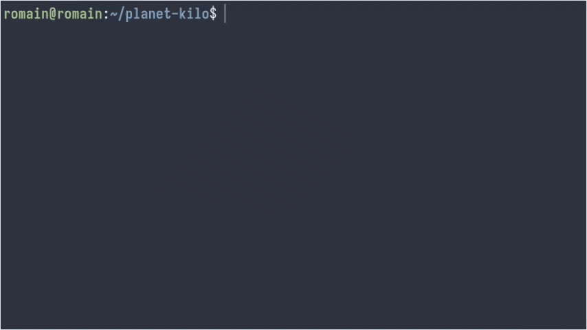

## Port of the Kilo text editor to planet

This is a port of the [antirez/kilo](https://github.com/antirez/kilo) text editor and the [antirez/sds](https://github.com/antirez/sds) library to `planet`.  
<!---->
[planet](https://github.com/romainducrocq/planet) is a C-like programming language with a fully selfhosted compiler, written from scratch for GNU/Linux, MacOS and FreeBSD. It compiles programs to native x86-64 assembly and uses the C standard library at runtime. I'm using Kilo and SDS to test my language on "relatively" large programs (> 2000 loc).  
<!---->
`planet-kilo` was extended to support syntax highlighting for both `planet` and C/C++, but is otherwise faithfull to the original implementation (that said, it fixes a few bugs along the way). `sds.plx.m4` has been changed to a single-file library (stb-style). These ports also utilize the [m4 macro preprocessor](https://www.gnu.org/software/m4/m4.html).  
<!---->
Try it out: `HELP: Ctrl-S = save | Ctrl-Q = quit | Ctrl-F = find`  

### Quick install

See the language's repo for more info, or get started now:  
```
$ git clone --depth 1 --branch master --recurse-submodules --shallow-submodules https://github.com/romainducrocq/planet
$ cd planet/bin/
$ ./configure.sh
$ ./make.sh
$ ./install.sh
$ . ~/.bashrc # or . ~/.zshrc or . ~/.shrc
$ ./selfhost.sh
$ ./selfhost.sh
```

### Build and Run

Build `kilo.plx` with the `planet` compiler  
```
$ ./build.sh
```
and start your coding session :coffee:  
```
$ ./kilo <filename>
```

### Demos

```
# Edit files
$ ./kilo kilo.plx
$ ./kilo sds.plx.m4
$ ./kilo demo_sds.plx

# Run sds demo
$ planet -E demo_sds.plx && ./demo_sds
Hello World from a simple dynamic string!
```

  

****

@romainducrocq
